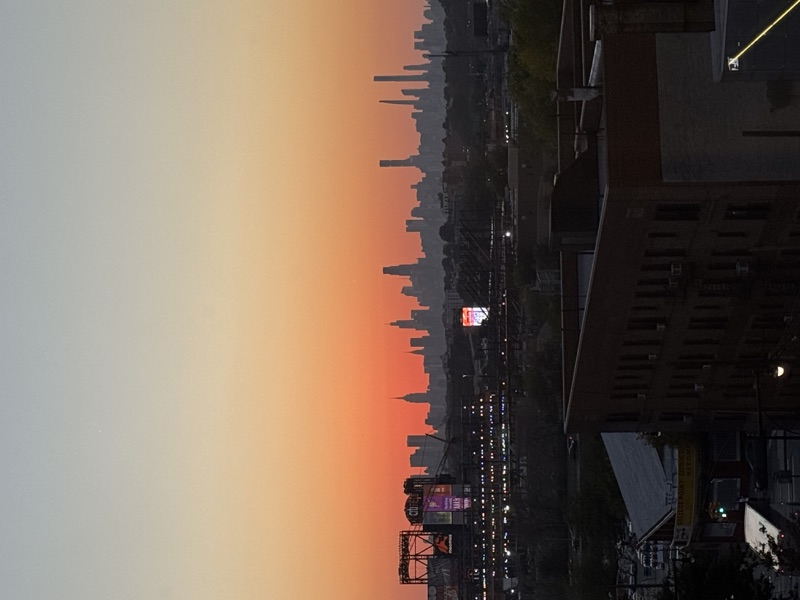

This page is a style reference for future posts. It uses the same layout and typography as the blog, and stays outside the personal post feed.

## Start a new post

Copy this starter into a Markdown file named `YYYY-MM-DD-your-title.md` in `_posts/`, or use the [post composer](/login/). Replace the example text, date, and image path with your own.

```yaml
---
layout: post
title: "Your post title"
description: "A short introduction to this post."
date: 2026-11-11 12:00:00 -0600
tags: [blog]
image: "/images/your-photo.jpg"
---

Your opening paragraph goes here.
```

The title comes from the front matter, so begin the body with a paragraph and use second-level headings for its main sections. Leave out `image` if the post does not need a cover photograph. Set `featured: false` to keep a post in the archive without putting it on the homepage.

## Text and typography

A regular paragraph should be comfortable to read on a phone or a larger screen. Use **bold text** to emphasize an idea, *italics* for a gentle emphasis, ~~strikethrough~~ for a correction, and `inline code` for filenames or short snippets. Here is an example of a [text link](/about/).

### A smaller section heading

Use third-level headings to organize ideas within a section. Paragraphs, headings, and links inherit the website’s fonts and colors automatically, including dark mode.

#### A fourth-level heading

This heading is useful for a short subsection. A post usually needs only two or three heading levels.

## Lists

- One observation or idea.
- A second point, with **emphasis** where it helps.
  - A related detail underneath it.

1. Introduce the topic.
2. Share the story or explain the process.
3. End with what you learned.

### A checklist

- [x] Write a first draft.
- [ ] Add photographs and captions.
- [ ] Review links before publishing.

## A quotation

> A blockquote gives a passage room to breathe. It can hold a quotation or an idea worth pausing on.
>
> Add the source or attribution underneath when quoting someone.

## A photograph and caption

<figure class="blog-figure">
  
  <figcaption>A short caption gives the photograph context. Add a photo credit when appropriate.</figcaption>
</figure>

```html
<figure class="blog-figure">
  
  <figcaption>Your caption and photo credit.</figcaption>
</figure>
```

### Two photographs together

<div class="blog-image-pair">
  <figure class="blog-figure">
    
    <figcaption>A first moment.</figcaption>
  </figure>
  <figure class="blog-figure">
    
    <figcaption>A second moment.</figcaption>
  </figure>
</div>

Wrap two `blog-figure` elements in a `blog-image-pair` container to use this layout. On smaller screens, the photographs stack vertically. Click a photograph to view it larger.

## Code

```python
def collect_moments(notes):
    return [note for note in notes if note.strip()]

memories = collect_moments(["A good day on the court", "A new idea"])
```

Fenced code blocks preserve formatting and use syntax highlighting. Add the language name after the opening backticks.

## A table

| Element | What to put here | When it helps |
| --- | --- | --- |
| Title | A clear, specific name | Every post |
| Description | A short summary | Previews and sharing |
| Caption | Context and attribution | Photographs |

---

## Video posts and vlogs

Blog posts can include your own videos as well as writing and photographs. To place a video at the top of a post, add its embed URL to the front matter:

```yaml
video_embed: "https://www.youtube.com/embed/YOUR_VIDEO_ID"
```

Use the video’s embed URL, then write the accompanying story underneath it. This reference intentionally does not embed anyone else’s video.

## Before publishing

Check the title and date, proofread the text, describe images for readers who cannot see them, and credit work that belongs to someone else. Preview the post in both light and dark mode.

[Open the post composer](/login/)
